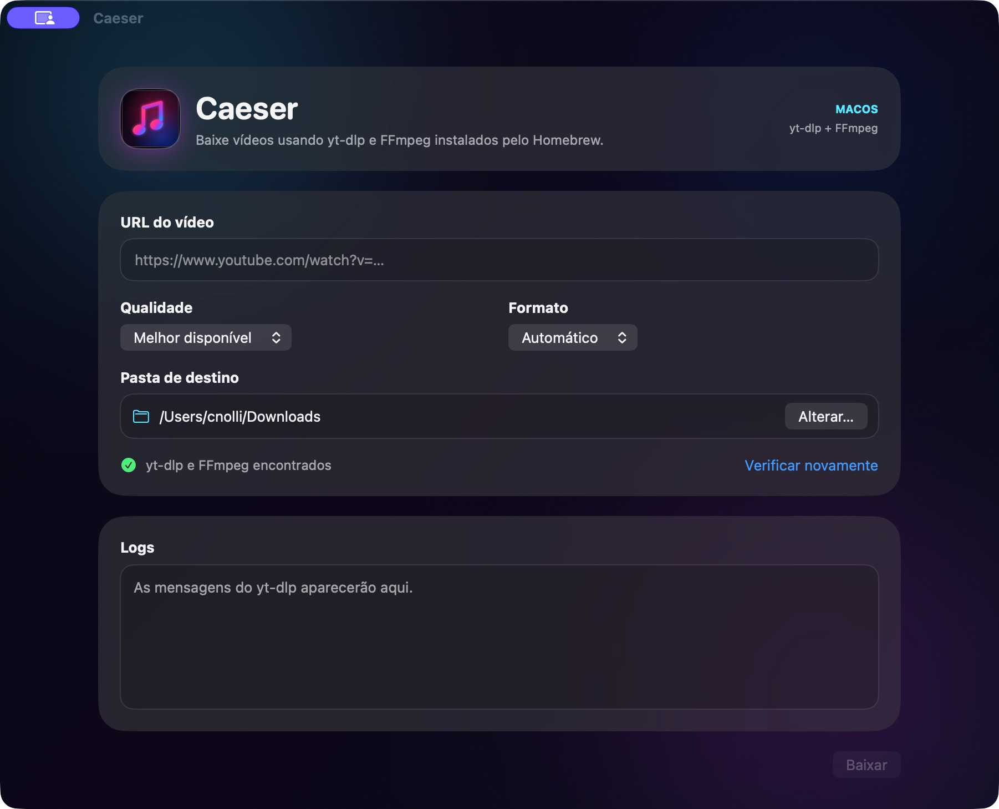

# Caeser

**Download de vídeos e áudio em uma interface nativa para macOS.**

O Caeser reúne as opções do **yt-dlp** e do **FFmpeg** em um aplicativo feito com **Swift e SwiftUI**. Cole o endereço do vídeo, escolha a qualidade, o formato e a pasta de destino e acompanhe a operação pela interface.



*Tela principal do aplicativo, pronta para receber uma URL, com as dependências detectadas no sistema.*

## Proposta do projeto

O projeto explora a integração de ferramentas de linha de comando com uma aplicação gráfica. A interface concentra as opções de download, enquanto o yt-dlp realiza a obtenção da mídia e utiliza o FFmpeg quando precisa converter áudio ou combinar faixas.

Os executáveis são instalados separadamente pelo Homebrew. Eles não são incorporados ao aplicativo.

## Recursos

- Entrada de URLs HTTP e HTTPS, com validação antes de iniciar.
- Seleção de qualidade: **melhor disponível**, **até 4K**, **1440p**, **1080p**, **720p** ou **480p**.
- Formatos **Automático**, **MP4**, **WebM** e **MP3**.
- Escolha da pasta de destino pelo seletor nativo do macOS.
- Detecção de yt-dlp e FFmpeg, com opção para verificar novamente.
- Acompanhamento do progresso, da velocidade e da estimativa de tempo quando informados pelo yt-dlp.
- Área de logs para acompanhar as etapas e investigar erros.
- Cancelamento do processo de download.

A qualidade escolhida funciona como um limite de resolução: o resultado depende dos formatos disponíveis na origem. A conversão para MP3 utiliza a melhor faixa de áudio disponível e a opção `--audio-quality 0`; ela não melhora a qualidade do áudio original.

## Tecnologias e arquitetura

| Componente | Responsabilidade |
| --- | --- |
| SwiftUI | Interface, seleção de opções e atualização dos estados visuais. |
| AppKit | Seleção da pasta de destino com `NSOpenPanel`. |
| Foundation | URLs, arquivos, processos externos e leitura da saída. |
| yt-dlp | Extração e download da mídia. |
| FFmpeg | Conversão de áudio e combinação de vídeo e áudio quando necessário. |
| WebKit | Exibição da logo SVG na interface. |

```text
Sources/VideoDownloader/
├── VideoDownloaderApp.swift   Entrada do aplicativo
├── ContentView.swift          Interface e componentes visuais
├── DownloadViewModel.swift    Estado, validação e acompanhamento do download
├── DownloadModels.swift       Qualidades, formatos e argumentos do yt-dlp
├── DownloadProcess.swift      Execução, saída e cancelamento do processo
├── DependencyLocator.swift    Localização dos executáveis
└── Resources/                 Logo SVG
Assets.xcassets/               Ícone e recursos visuais
VideoDownloader.xcodeproj/     Projeto do Xcode
Package.swift                 Configuração do Swift Package Manager
docs/images/                  Captura da interface
```

Os argumentos são enviados diretamente a `Foundation.Process`, sem montar comandos para um shell. A saída padrão e a saída de erros são lidas por um pipe, exibidas nos logs e interpretadas para atualizar o progresso na interface. O estado da tela é gerenciado no `MainActor`.

## Como executar

### Requisitos

- macOS 26 ou posterior.
- Xcode compatível com macOS 26.
- Homebrew com **yt-dlp** e **FFmpeg** instalados.
- Conexão com a internet para acessar a mídia.

Instale as dependências:

```bash
brew install yt-dlp ffmpeg
```

O aplicativo procura os executáveis nos caminhos padrão do Homebrew no Mac: `/opt/homebrew/bin` e `/usr/local/bin`.

### Pelo Xcode

1. Clone o repositório:

   ```bash
   git clone https://github.com/cnolli-fl/Caeser.git
   cd Caeser
   ```

2. Abra [VideoDownloader.xcodeproj](VideoDownloader.xcodeproj).
3. Selecione o esquema **Caeser** e o destino **My Mac**.
4. Execute com **Command + R**.

O projeto também contém um [Package.swift](Package.swift), configurado para Swift tools 6.2. O projeto do Xcode é o caminho recomendado para executar a janela do aplicativo e preparar um `.app` distribuível.

## Como usar

1. Confira o indicador **yt-dlp e FFmpeg encontrados**.
2. Cole uma URL de vídeo no campo de endereço.
3. Escolha a qualidade e o formato. Para extrair somente o áudio, selecione **MP3**.
4. Use **Alterar…** para escolher a pasta de destino.
5. Clique em **Baixar** e acompanhe o status e os logs.

No modo automático, o yt-dlp seleciona os formatos disponíveis conforme a qualidade solicitada. Para MP4 ou WebM, o FFmpeg pode ser chamado para combinar as faixas. O aplicativo solicita um vídeo por operação, com playlists desativadas.

## Problemas comuns

| Situação | O que conferir |
| --- | --- |
| Dependência não encontrada | Instale `yt-dlp` e `ffmpeg` pelo Homebrew e use **Verificar novamente**. |
| URL inválida | Verifique se o endereço começa com `http://` ou `https://`. |
| Erro ao baixar | Consulte os logs; disponibilidade, restrições e suporte ao site dependem da origem e do yt-dlp. |
| Falha ao salvar | Confira se a pasta de destino existe e permite gravação. |
| Qualidade diferente da escolhida | A resolução selecionada é um teto; a origem precisa disponibilizar uma versão compatível. |

Quando o site muda e o yt-dlp deixa de funcionar, atualizar as dependências pode ajudar:

```bash
brew upgrade yt-dlp ffmpeg
```

## Limites da versão atual

- Uma operação de download por vez, sem fila ou gerenciamento de playlists.
- Dependência de ferramentas externas instaladas no sistema.
- Sem fluxo de autenticação com contas de serviços na interface.
- Sem suíte de testes automatizados no repositório nesta versão.

O aplicativo não implementa contorno de DRM. Use-o com conteúdo que você tenha autorização para baixar e respeite os termos do serviço de origem.

## Licença

Este projeto é open source e está disponível sob a [licença MIT](LICENSE). Você pode usar, modificar e distribuir o código, mantendo o aviso de copyright e a licença.

## Autor

Projeto pessoal de **Caio Nolli**.

[GitHub](https://github.com/cnolli-fl) · [LinkedIn](https://www.linkedin.com/in/caio-nolli-843580388/)
